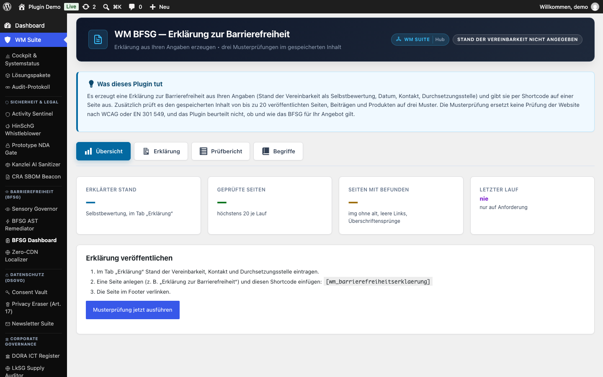
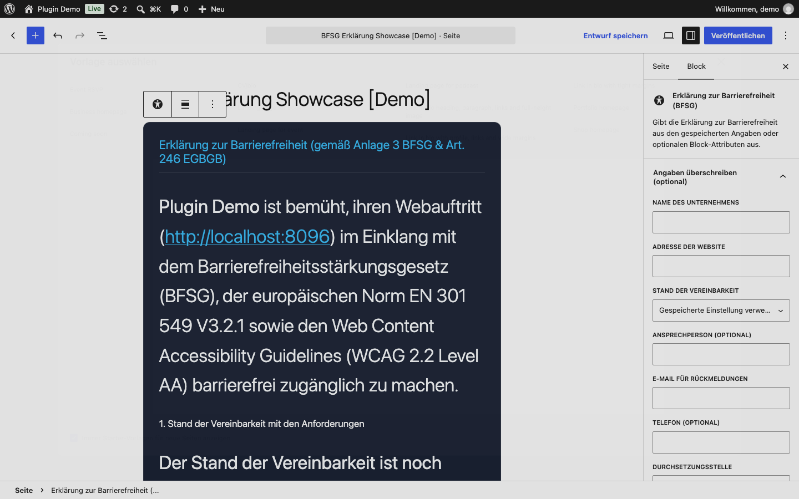
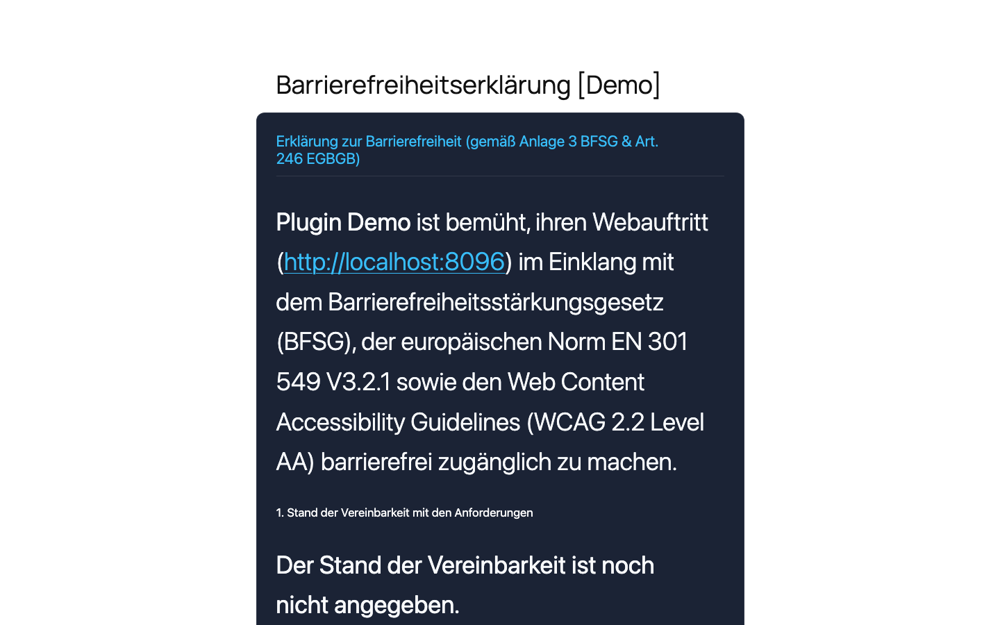
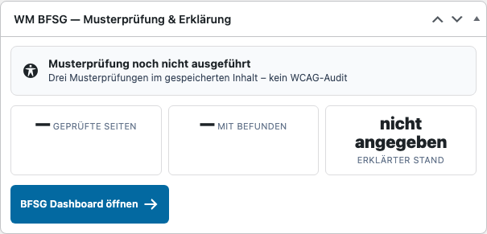

# WM BFSG Compliance Dashboard (Deutsche Dokumentation)

<p align="center">
  <a href="README.md"></a>
  <a href="README.de.md"></a>
  <a href="README.es.md"></a>
</p>

> **Erzeugt die Erklärung zur Barrierefreiheit aus den Angaben des Betreibers und führt drei Musterprüfungen auf dem gespeicherten Inhalt von bis zu 20 veröffentlichten Seiten durch — eine Formulierungshilfe für eine Selbstbewertung, kein WCAG-Audit und keine rechtliche Bewertung**  
> **Plugin-Seite:** [https://arnoldwender.com/wordpress-plugins/wm-bfsg-compliance-dashboard/](https://arnoldwender.com/wordpress-plugins/wm-bfsg-compliance-dashboard/)  
> **Mit einem agentischen Workflow entwickelt:** entstanden mit KI-Coding-Agenten. Prüfen und testen Sie es wie jeden fremden Code, bevor Sie es produktiv einsetzen.  
> **Support & Haftung:** Kein Support (Zero Support) — reproduzierbare Bugs ausschließlich über [GitHub Issues](https://github.com/arnoldwender/wm-wp-bfsg-compliance-dashboard/issues) · kein privater Support · OHNE GEWÄHR („AS IS“) / keine Haftung ([SUPPORT.md](SUPPORT.md))

> Diese Datei beschreibt ausschließlich den tatsächlichen Funktionsumfang des Plugins (`v1.2.2`): Generator für die Erklärung zur Barrierefreiheit aus Betreiberangaben, drei Shortcodes und Gutenberg-Block (`wm/bfsg-anlage-3`), drei Musterprüfungen im gespeicherten Inhalt von bis zu 20 veröffentlichten Einträgen, Backend-Übersicht, WP-CLI (`wp bfsg-audit scan` und `anlage3`), REST-Routen unter `wm-bfsg-dashboard/v1` (`/run-audit`, `/preview-declaration`, `/audit-certificate`), Entwickler-Hooks, WordPress 6.5+ Block Bindings, GenerateBlocks 2.x Dynamic Tag sowie einen Spoke-Adapter für den WM Suite Hub. Alle Daten liegen in WordPress-Optionen; es gibt keine eigenen Datenbanktabellen, keinen PDF- oder CSV-Export, keine ausgehenden Anfragen und keine Rechtsbewertung zur Anwendbarkeit des BFSG.

---

## Screenshots

!WM BFSG Compliance Dashboard Banner

| Screenshot | Beschreibung |
| --- | --- |
|  | Cockpit zur Erstellung der Erklärung zur Barrierefreiheit (BFSGV Anlage 3) |
|  | Gutenberg-Block-Editor mit eingefügtem Block wm/bfsg-anlage-3 |
|  | Veröffentlichte Erklärung zur Barrierefreiheit im Frontend via Shortcode oder Block |
|  | Dashboard-Widget zur Statusanzeige der hinterlegten Barrierefreiheitserklärung |

---

## Was das Plugin leistet

1. **Erklärung zur Barrierefreiheit:** `Anlage3Generator::generate_declaration()` erzeugt eine deutsche HTML-Erklärung in vier Abschnitten: Stand der Vereinbarkeit als Selbstbewertung des Betreibers (`vollständig konform`, `größtenteils konform` oder `nicht konform`; ohne Angabe steht dort „Der Stand der Vereinbarkeit ist noch nicht angegeben.“), das gespeicherte Datum der Selbstbewertung (ohne Datum: „Das Erstellungsdatum ist noch nicht angegeben.“) mit dem Hinweis auf die Selbstbewertung, Kontakt für Rückmeldungen (E-Mail; Ansprechperson und Telefon nur, wenn angegeben) und Durchsetzungsverfahren mit der eingetragenen Stelle. Eine Schlusszeile sagt, dass keine Zertifizierung durch eine externe Stelle zugrunde liegt. Die Werte kommen aus den Einstellungen, danach von der Website (Name, Startadresse, Admin-E-Mail); über den Betreiber wird nichts erfunden.
2. **Shortcodes und Gutenberg-Block:** `[wm_barrierefreiheitserklaerung]`, `[wm_bfsg_anlage_3]` und `[wm_bfsg_statement]` geben die Erklärung aus. Die Attribute `company`, `url`, `level`, `email`, `phone`, `officer` und `authority` überschreiben auf dieser Seite die gespeicherten Einstellungen; unbekannte Attribute werden verworfen. Der Gutenberg-Block `wm/bfsg-anlage-3` (`blocks/anlage-3/block.json`, Editor-Skript `wm-bfsg-dashboard-blocks-editor`) erscheint im Block-Inserter mit `InspectorControls` und Live-Vorschau über `ServerSideRender`.
3. **Musterprüfungen:** `AccessibilityAuditor::run_audit()` liest den gespeicherten `post_content` von bis zu 20 veröffentlichten Seiten, Beiträgen und Produkten (neueste zuerst, angeheftete Beiträge nicht vorgezogen) und sucht drei Muster: `img`-Elemente ohne `alt`-Attribut (WCAG 1.1.1), Links ohne Text und ohne `aria-label`, `aria-labelledby` oder `title` (WCAG 2.4.4) und übersprungene Überschriftenebenen (WCAG 1.3.1). Jeder Eintrag beginnt mit 100 Punkten und verliert 10 je Befund, begrenzt auf 30, 20 und 20 je Prüfung; die Gesamtpunktzahl ist der Mittelwert. Ohne geprüften Inhalt gibt es keine Punktzahl (`null`, Zustand `NOTHING_CHECKED`), nie 100. Jeder Eintrag wird als `findings` oder `no_findings` markiert, nie mit einem Konformitätslabel; die Befundtexte sind deutsch. Das Ergebnis wird in der Option `wm_bfsg_last_audit_results` gespeichert. Die Prüfungen laufen nur auf Anforderung.
4. **Backend:** Menü *BFSG Dashboard* (Position 82), Seite `wm-bfsg-dashboard`, deutsche Oberfläche mit vier Tabs: Übersicht (erklärter Stand, geprüfte Seiten, Seiten mit Befunden, letzter Lauf, die drei Schritte zur Veröffentlichung, Schaltfläche zum Ausführen der Prüfungen); Erklärung (Formular mit Datum der Selbstbewertung, Stand auf die drei Werte begrenzt, Opt-in-Option für Datenlöschung bei Deinstallation, Vorschau via `wp_kses_post`); Prüfbericht des letzten Laufs (Kennung, Zeitpunkt, Prüfungen, Ergebnis und Befunde je Seite, mit dem Hinweis, dass er weder Zertifikat noch Aussage über Rechtskonformität ist); kurze Begriffsliste. Ein Dashboard-Widget zeigt den gespeicherten Lauf und den erklärten Stand, ohne etwas auszuführen. Admin-Stylesheets der WM-Suite-Familie.
5. **REST und WP-CLI** (`manage_options`): `POST /wp-json/wm-bfsg-dashboard/v1/run-audit` (`success` false, wenn nichts zu prüfen war), `GET /wp-json/wm-bfsg-dashboard/v1/preview-declaration` (Erklärung aus den gespeicherten Einstellungen), `GET /wp-json/wm-bfsg-dashboard/v1/audit-certificate` (Zusammenfassung des gespeicherten Laufs, nur lesend); `wp bfsg-audit scan` (bricht mit Fehler ab, wenn nichts zu prüfen war, und listet die Befunde) und `wp bfsg-audit anlage3` (Erklärung aus den gespeicherten Einstellungen als Text).
6. **Erweiterbarkeit & Block-Integrationen:** Filter `wm_bfsg_dashboard_declaration_html` und `wm_bfsg_dashboard_audit_report`, Actions `wm_bfsg_dashboard_ready` und `wm_bfsg_dashboard_audit_completed`, WordPress 6.5+ Block Bindings (`wm-bfsg-dashboard/metrics`) sowie GenerateBlocks 2.x Dynamic Tag (`{{wm_bfsg_dashboard_metric}}`).
7. **WM Suite Hub Spoke:** `includes/Adapters/Bfsg_Dashboard_Spoke_Adapter.php` meldet sich über `wm_register_suite_module`: Health `NEEDS_CONFIG`, bis ein Lauf Inhalte geprüft hat, `HEALTHY` ab einer mittleren Punktzahl von 80, darunter `DEGRADED`; Telemetrie mit Punktzahl, geprüften Seiten, Seiten mit Befunden, Prüfzustand, erklärtem Stand (`NOT_SET`, wenn nicht angegeben) und letztem Lauf; Aktionen `self_test` und `run_audit`, die fehlschlagen, wenn nichts geprüft wurde.

### Nicht enthalten

Keine Prüfung der ausgelieferten Website (Theme, Menüs, Widgets, Formulare, Kontraste, Tastaturbedienung, ARIA, Skripte); kein Test nach WCAG 2.2, BITV 2.0 oder EN 301 549; keine Prüfung über 20 Einträge hinaus; kein PDF-, CSV- oder sonstiger Dateiexport; kein Zertifikat, kein Siegel und keine eigene Datenbanktabelle; keine geplante oder laufende Überwachung; kein Feedback-Postfach; keine Bewertung, ob und wie das BFSG für ein Angebot gilt.

---

## Schnellstart

1. Plugin installieren und aktivieren (WordPress 6.4+, PHP 8.2+).
2. **BFSG Dashboard › Erklärung** öffnen und Unternehmen, Website, das Datum der Selbstbewertung, den Stand der Vereinbarkeit, den Ihre eigene Prüfung der Website trägt, die E-Mail für Rückmeldungen sowie, falls gewünscht, Ansprechperson und Telefonnummer eintragen. Durchsetzungsstelle prüfen und speichern.
3. Eine Seite anlegen (z. B. „Erklärung zur Barrierefreiheit“), den Block **Erklärung zur Barrierefreiheit (BFSG)** oder `[wm_barrierefreiheitserklaerung]` einfügen, veröffentlichen und im Footer verlinken.
4. Optional in der Übersicht **Musterprüfung jetzt ausführen** und die Befunde unter **Prüfbericht** lesen.

Klassen, Routen, Befehle, Hooks, Optionen und bekannte Einschränkungen: **[README.md](README.md)** (Referenz) und **[DEVELOPERS.md](DEVELOPERS.md)**.

```bash
php tests/test-suite.php         # Prüfungen, Erklärung, Bericht, Adapter, Shortcode, Block, Hooks, Deinstallation, Backend, REST
php tests/test-pot-freshness.php # jeder übersetzbare String steht in der .pot
bash tests/run-mutations.sh      # jede Mutation macht eine Korrektur rückgängig; die Suite muss rot werden
# innerhalb von WordPress:
wp eval-file wp-content/plugins/wm-bfsg-compliance-dashboard/tests/test-anlage3-claims.php --allow-root
```

### Bekannte Einschränkungen

- Der Abschnitt zum Durchsetzungsverfahren druckt unter der eingetragenen Stelle „Aufsichtsbehörde für digitale Barrierefreiheit • Bundesland Sachsen-Anhalt“ und die E-Mail-Adresse der Stelle in Sachsen-Anhalt, und die Überschrift nennt „Anlage 3 BFSG & Art. 246 EGBGB“; das Formular weist darauf hin.
- Der Einleitungssatz nennt auf jeder Website BFSG, EN 301 549 V3.2.1 und WCAG 2.2 Level AA als Ziel.
- Die Musterprüfungen sehen nur gespeicherten Beitragsinhalt: Shortcodes, per PHP gerenderte Blöcke, anderswo gespeicherte Page-Builder-Daten und das Theme werden nicht geprüft; ein Link, der nur ein Bild enthält, wird nicht gemeldet; die Überschriftenprüfung kennt das `<h1>` des Themes nicht.
- Die Erklärung trägt Inline-Styles für eine dunkle Box mit festen Farben.
- Wurden die Angaben vor dem 2026-09-15 gespeichert, ist kein Datum hinterlegt: Die Erklärung nennt das Erstellungsdatum als nicht angegeben, bis das Formular erneut gespeichert wird.

---

## Konformität

- **Was das Plugin feststellt:** ob drei Muster im gespeicherten Inhalt von bis zu 20 veröffentlichten Einträgen vorkommen, und einen Erklärungstext aus den Angaben des Betreibers. Es prüft die Website nicht nach WCAG 2.2 oder EN 301 549, bewertet nicht, ob und wie das BFSG für ein Angebot gilt, und macht die Erklärung nicht zutreffend: Der erklärte Stand der Vereinbarkeit ist die eigene Aussage des Betreibers, und eine Musterprüfung ohne Befunde trägt keinen Stand.
- **Ausgehende Anfragen:** keine.
- **Datenschutz:** es werden keine Besucherdaten erhoben; das Plugin speichert die Angaben für die Erklärung, den letzten Prüflauf (mit Seitentiteln und URLs) und die Deinstallationspräferenz in WordPress-Optionen. Standardmäßig bleiben die Daten bei der Deinstallation erhalten und werden nur gelöscht, wenn der Administrator dies über `wm_bfsg_dashboard_delete_data_on_uninstall` aktiviert.

---

## Lizenz

Vertrieben unter der **GNU General Public License v2 oder neuer** (`GPL-2.0-or-later`).  
Copyright (C) 2026 Arnold Wender.  
