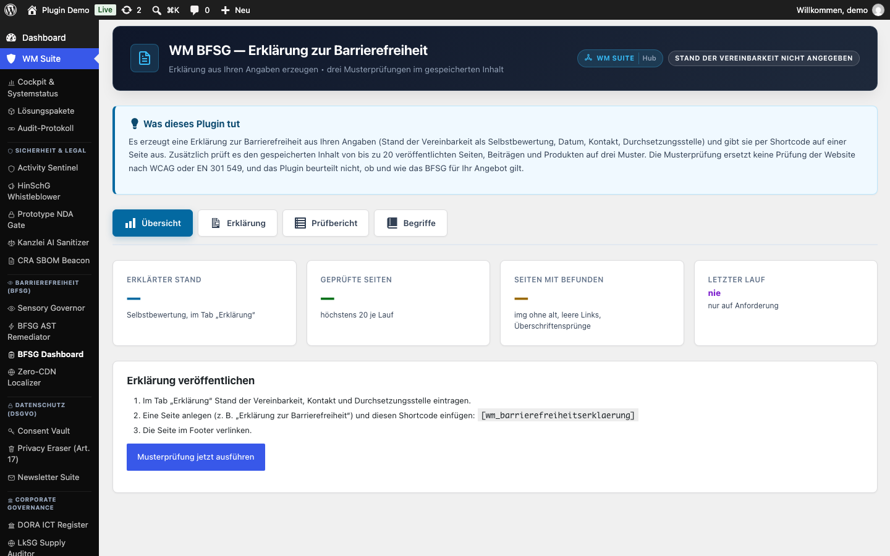
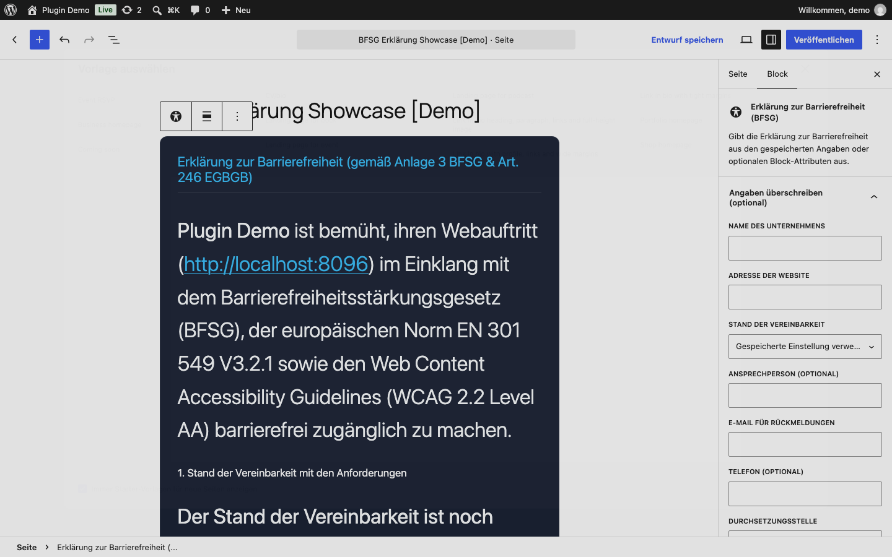
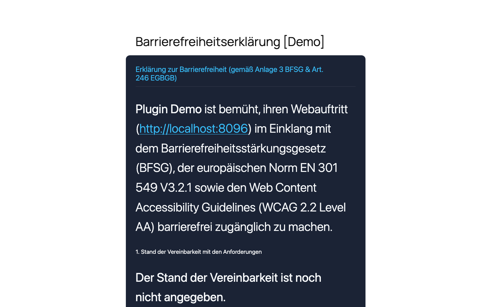
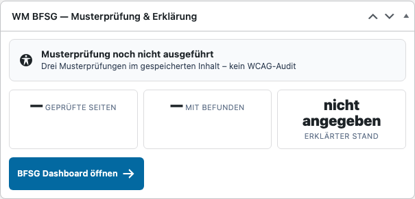

# WM BFSG Compliance Dashboard (Documentación en Español)

<p align="center">
  <a href="README.md"></a>
  <a href="README.de.md"></a>
  <a href="README.es.md"></a>
</p>

> **Genera la declaración de accesibilidad alemana (Erklärung zur Barrierefreiheit) a partir de los datos que captura el operador y aplica tres comprobaciones de patrones al contenido guardado de hasta 20 páginas publicadas — una ayuda de redacción para una autoevaluación, no una auditoría WCAG ni un dictamen legal**  
> **Página del Plugin:** [https://arnoldwender.com/es/plugins-wordpress/wm-bfsg-compliance-dashboard/](https://arnoldwender.com/es/plugins-wordpress/wm-bfsg-compliance-dashboard/)  
> **Desarrollado con un agentic workflow:** creado con agentes de programación de IA. Revísalo y pruébalo como cualquier código de terceros antes de usarlo en producción.  
> **Soporte y responsabilidad:** Cero soporte (Zero Support) — errores reproducibles únicamente en [GitHub Issues](https://github.com/arnoldwender/wm-wp-bfsg-compliance-dashboard/issues) · sin soporte privado · TAL CUAL («AS IS») / sin responsabilidad ([SUPPORT.md](SUPPORT.md))

> Este archivo describe únicamente lo que el plugin entrega (`v1.2.2`): un generador de declaración de accesibilidad alimentado por los ajustes del operador, tres shortcodes y un bloque Gutenberg (`wm/bfsg-anlage-3`), tres comprobaciones de patrones sobre el contenido guardado de hasta 20 páginas publicadas, panel de administración, WP-CLI (`wp bfsg-audit scan` y `anlage3`), rutas REST bajo `wm-bfsg-dashboard/v1` (`/run-audit`, `/preview-declaration` y `/audit-certificate`), hooks para desarrolladores, WordPress 6.5+ Block Bindings, etiqueta dinámica de GenerateBlocks 2.x y adaptador spoke para WM Suite Hub. Todos los datos se almacenan en opciones de WordPress; no hay tablas personalizadas, ni exportación PDF o CSV, ni peticiones salientes, ni evaluación legal sobre si el BFSG aplica a una oferta.

---

## Capturas de pantalla

!Banner de WM BFSG Compliance Dashboard

| Captura | Descripción |
| --- | --- |
|  | Panel generador de la declaración de accesibilidad (BFSG Anlage 3) |
|  | Editor de bloques Gutenberg con wm/bfsg-anlage-3 y panel lateral |
|  | Declaración de accesibilidad publicada en el frontend mediante shortcode o bloque |
|  | Widget del escritorio con el estado de la declaración configurada |

---

## Qué hace el plugin

1. **Declaración de accesibilidad.** `Anlage3Generator::generate_declaration()` arma una declaración HTML en alemán con cuatro secciones: el grado de conformidad como autoevaluación del operador (`vollständig konform`, `größtenteils konform` o `nicht konform`; sin valor, la declaración dice «Der Stand der Vereinbarkeit ist noch nicht angegeben.»), la fecha de la autoevaluación que guardó el operador (sin fecha: «Das Erstellungsdatum ist noch nicht angegeben.») con la nota de que se basa en una autoevaluación, el contacto para comentarios (correo; persona de contacto y teléfono solo si están capturados) y el procedimiento de aplicación con el organismo configurado. Una línea final dice que no la respalda ninguna certificación externa. Los valores salen de los ajustes y, si faltan, del sitio (nombre, URL de inicio, correo del administrador); no se inventa nada sobre el operador.
2. **Shortcodes y bloque Gutenberg.** `[wm_barrierefreiheitserklaerung]`, `[wm_bfsg_anlage_3]` y `[wm_bfsg_statement]` imprimen la declaración. Los atributos `company`, `url`, `level`, `email`, `phone`, `officer` y `authority` sustituyen los ajustes guardados en esa página; los atributos desconocidos se descartan. El bloque `wm/bfsg-anlage-3` (`blocks/anlage-3/block.json`, script de editor `wm-bfsg-dashboard-blocks-editor`) aparece en el insertador de bloques con `InspectorControls` y vista previa mediante `ServerSideRender`.
3. **Comprobaciones de patrones.** `AccessibilityAuditor::run_audit()` lee el `post_content` guardado de hasta 20 páginas, entradas y productos publicados (los más recientes primero, sin adelantar las entradas fijadas) y busca tres patrones: elementos `img` sin atributo `alt` (WCAG 1.1.1), enlaces sin texto y sin `aria-label`, `aria-labelledby` ni `title` (WCAG 2.4.4) y niveles de encabezado saltados hacia abajo (WCAG 1.3.1). Cada elemento empieza con 100 puntos y pierde 10 por hallazgo, con tope de 30, 20 y 20 por comprobación; la puntuación general es el promedio. Sin contenido revisado no hay puntuación (`null`, estado `NOTHING_CHECKED`), nunca 100. Cada elemento se marca `findings` o `no_findings`, nunca con una etiqueta de conformidad; los textos de los hallazgos están en alemán. El resultado se guarda en la opción `wm_bfsg_last_audit_results`. Las comprobaciones solo corren cuando se piden.
4. **Administración.** Menú *BFSG Dashboard* (posición 82), página `wm-bfsg-dashboard`, interfaz en alemán con cuatro pestañas: resumen (grado declarado, páginas revisadas, páginas con hallazgos, última ejecución, los tres pasos para publicar la declaración, el botón que ejecuta las comprobaciones); declaración (formulario con la fecha de la autoevaluación, grado limitado a los tres valores, casilla opcional para borrar datos al desinstalar, vista previa escapada con `wp_kses_post`); informe de la última ejecución (identificador, hora, comprobaciones, resultado y tabla de hallazgos por página, con la nota de que no es un certificado ni una afirmación de conformidad legal); una lista breve de términos. Un widget del escritorio muestra la ejecución guardada y el grado declarado sin ejecutar nada. Hojas de estilo de la familia de administración de WM Suite.
5. **REST y WP-CLI** (`manage_options`): `POST /wp-json/wm-bfsg-dashboard/v1/run-audit` (`success` false cuando no había nada que revisar), `GET /wp-json/wm-bfsg-dashboard/v1/preview-declaration` (declaración con los ajustes guardados), `GET /wp-json/wm-bfsg-dashboard/v1/audit-certificate` (resumen de la ejecución guardada, solo lectura); `wp bfsg-audit scan` (termina con error cuando no había nada que revisar y lista los hallazgos) y `wp bfsg-audit anlage3` (declaración con los ajustes guardados como texto).
6. **Extensibilidad e integraciones de bloques.** Expone los filtros `wm_bfsg_dashboard_declaration_html` y `wm_bfsg_dashboard_audit_report`, las acciones `wm_bfsg_dashboard_ready` y `wm_bfsg_dashboard_audit_completed`, la fuente de Block Bindings de WordPress 6.5+ `wm-bfsg-dashboard/metrics` y la etiqueta dinámica de GenerateBlocks 2.x `{{wm_bfsg_dashboard_metric}}`.
7. **Spoke de WM Suite Hub.** `includes/Adapters/Bfsg_Dashboard_Spoke_Adapter.php` se registra con `wm_register_suite_module`: salud `NEEDS_CONFIG` hasta que una ejecución revisó contenido, `HEALTHY` desde una puntuación media de 80, `DEGRADED` por debajo; telemetría con puntuación, páginas revisadas, páginas con hallazgos, estado de la revisión, grado declarado (`NOT_SET` si no hay) y última ejecución; acciones `self_test` y `run_audit`, que fallan cuando no se revisó nada.

### No incluido

Ninguna revisión del sitio renderizado (tema, menús, widgets, formularios, contraste de color, uso con teclado, ARIA, scripts); ninguna prueba según WCAG 2.2, BITV 2.0 o EN 301 549; ninguna revisión más allá de 20 elementos; ninguna exportación PDF, CSV u otro archivo; ningún certificado, sello ni tabla de base de datos personalizada; ningún monitoreo programado o continuo; ninguna bandeja de comentarios; ninguna evaluación de si el BFSG aplica a una oferta ni de cómo.

---

## Inicio rápido

1. Instala y activa el plugin (WordPress 6.4+, PHP 8.2+).
2. Abre **BFSG Dashboard › Erklärung** y captura la empresa, el sitio, la fecha de la autoevaluación, el grado de conformidad que respalda tu propia revisión del sitio, el correo para comentarios y, si quieres que aparezcan, una persona de contacto y un teléfono. Revisa el organismo de aplicación y guarda.
3. Crea una página (por ejemplo «Erklärung zur Barrierefreiheit»), inserta el bloque **Erklärung zur Barrierefreiheit (BFSG)** o `[wm_barrierefreiheitserklaerung]`, publícala y enlázala desde el pie de página.
4. Opcional: en el resumen ejecuta **Musterprüfung jetzt ausführen** y lee los hallazgos en **Prüfbericht**.

Clases, rutas, comandos, hooks, opciones y limitaciones conocidas: **[README.md](README.md)** (referencia) y **[DEVELOPERS.md](DEVELOPERS.md)**.

```bash
php tests/test-suite.php         # comprobaciones, declaración, informe, adaptador, shortcode, bloque, hooks, desinstalación, admin, REST
php tests/test-pot-freshness.php # cada cadena traducible del código tiene entrada en el .pot
bash tests/run-mutations.sh      # cada mutación deshace una corrección; la suite debe ponerse en rojo
# dentro de WordPress:
wp eval-file wp-content/plugins/wm-bfsg-compliance-dashboard/tests/test-anlage3-claims.php --allow-root
```

### Limitaciones conocidas

- La sección del procedimiento de aplicación imprime bajo el organismo configurado «Aufsichtsbehörde für digitale Barrierefreiheit • Bundesland Sachsen-Anhalt» y el correo de la oficina de Sajonia-Anhalt, y el encabezado cita «Anlage 3 BFSG & Art. 246 EGBGB»; el formulario informa de ello.
- La frase inicial nombra BFSG, EN 301 549 V3.2.1 y WCAG 2.2 Level AA como objetivo en todos los sitios.
- Las comprobaciones de patrones solo ven el contenido guardado de las entradas: shortcodes, bloques renderizados por PHP, datos de maquetadores guardados en otro lugar y el tema no se revisan; un enlace que solo contiene una imagen no se marca; la revisión de encabezados no conoce el `<h1>` del tema.
- La declaración lleva estilos en línea para una caja oscura con colores fijos.
- En sitios que guardaron los datos antes del 2026-09-15 no hay fecha guardada: la declaración dice que la fecha de creación no está indicada hasta que se vuelva a guardar el formulario.

---

## Cumplimiento

- **Lo que el plugin establece:** si tres patrones aparecen en el contenido guardado de hasta 20 elementos publicados, y un texto de declaración armado con lo que captura el operador. No prueba el sitio según WCAG 2.2 o EN 301 549, no evalúa si el BFSG aplica a una oferta ni cómo, y no vuelve cierta la declaración: el grado de conformidad declarado es afirmación del propio operador, y una revisión de patrones sin hallazgos no respalda ningún grado.
- **Peticiones salientes:** ninguna.
- **Privacidad:** no se recogen datos de visitantes; el plugin guarda los ajustes de la declaración, la última ejecución (con títulos y URL de páginas) y la preferencia de desinstalación en opciones de WordPress. Los datos se conservan por defecto al desinstalar y solo se eliminan cuando el administrador activa `wm_bfsg_dashboard_delete_data_on_uninstall`.

---

## Licencia

Distribuido bajo licencia **GNU General Public License v2 o posterior** (`GPL-2.0-or-later`).  
Copyright (C) 2026 Arnold Wender.  
