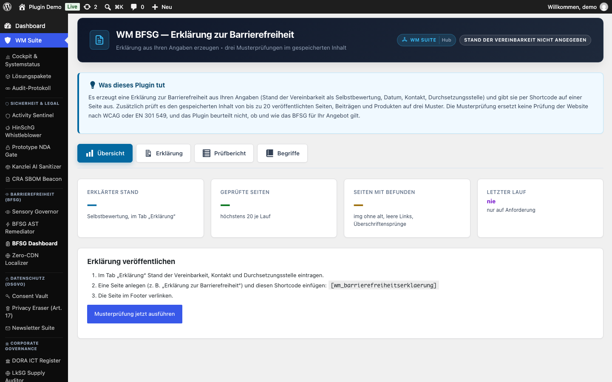
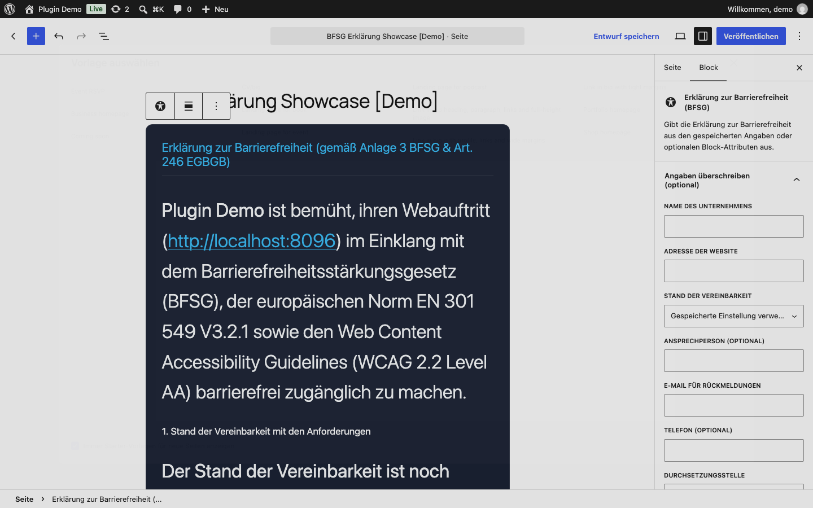
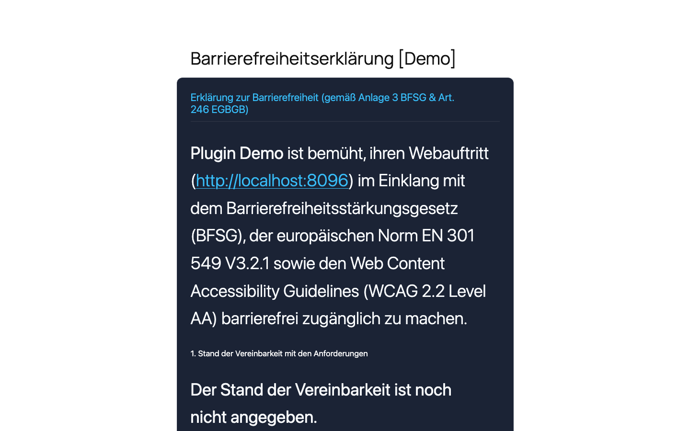
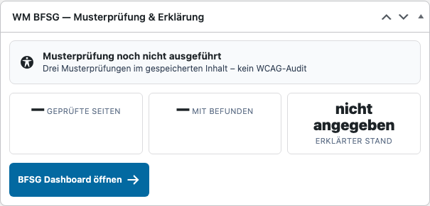

# WM BFSG Compliance Dashboard

<p align="center">
  <a href="README.md"></a>
  <a href="README.de.md"></a>
  <a href="README.es.md"></a>
</p>

<p align="center">
  <a href="https://wordpress.org"></a>
  <a href="https://php.net"></a>
  <a href="https://www.gnu.org/licenses/gpl-2.0.html"></a>
</p>

> **Builds the German accessibility statement (Erklärung zur Barrierefreiheit) from what the operator enters and runs three pattern checks on the stored content of up to 20 published pages — a drafting aid for a self-assessment, not a WCAG audit and not a legal verdict**  
> **Plugin Page:** [https://arnoldwender.com/wordpress-plugins/wm-bfsg-compliance-dashboard/](https://arnoldwender.com/wordpress-plugins/wm-bfsg-compliance-dashboard/)  
> **Built with an agentic workflow:** developed with AI coding agents. Review and test it like any third-party code before you use it in production.  
> **Support & Liability:** Zero support — reproducible bugs on [GitHub Issues](https://github.com/arnoldwender/wm-wp-bfsg-compliance-dashboard/issues) only · no private support · AS IS / no liability ([SUPPORT.md](SUPPORT.md))

> This README describes only what the plugin ships (`v1.2.2`): an accessibility statement generator driven by operator-supplied settings, three shortcodes and a Gutenberg block (`wm/bfsg-anlage-3`), three stored-content pattern checks across up to 20 published items, an admin dashboard, WP-CLI (`wp bfsg-audit scan` and `anlage3`), REST routes under `wm-bfsg-dashboard/v1` (`/run-audit`, `/preview-declaration` and `/audit-certificate`), developer hooks, WordPress 6.5+ Block Bindings, a GenerateBlocks 2.x Dynamic Tag and a WM Suite Hub spoke adapter. All data lives in WordPress options; the plugin creates no custom database tables, generates no PDF or CSV files, makes no outbound requests, and makes no legal assessment of whether or how the BFSG applies to an offer.

---

## Screenshots

!WM BFSG Compliance Dashboard banner

| Screenshot | Description |
| --- | --- |
|  | BFSG statement builder cockpit (Anlage 3) combining operator configuration and stored check metrics |
|  | Gutenberg Block Editor with wm/bfsg-anlage-3 inserted and sidebar inspector open |
|  | Published German accessibility statement rendered by [wm_bfsg_anlage_3] / block SSR |
|  | Dashboard widget summarizing stored accessibility statement configuration |

---

## What the plugin does

1. **Accessibility statement.** `Anlage3Generator::generate_declaration()` builds a German HTML statement in four sections: the level of conformity as the operator's self-assessment (one of `vollständig konform`, `größtenteils konform`, `nicht konform`; without one the statement says "Der Stand der Vereinbarkeit ist noch nicht angegeben."), the date of the self-assessment the operator saved (without one: "Das Erstellungsdatum ist noch nicht angegeben.") with the note that it rests on a self-assessment, the feedback contact (e-mail; contact person and phone only when they are set), and the enforcement procedure with the configured body. A closing line says that no external certification underlies it. Values come from the settings screen, then from the site (name, home URL, admin e-mail); nothing about the operator is invented.
2. **Shortcodes and Gutenberg block.** `[wm_barrierefreiheitserklaerung]`, `[wm_bfsg_anlage_3]` and `[wm_bfsg_statement]` print the statement. The attributes `company`, `url`, `level`, `email`, `phone`, `officer` and `authority` override the saved settings on that page; unknown attributes are dropped. The Gutenberg block `wm/bfsg-anlage-3` (`blocks/anlage-3/block.json`, editor script `wm-bfsg-dashboard-blocks-editor`) appears in the Block Inserter with `InspectorControls` for optional overrides and a live `ServerSideRender` preview.
3. **Pattern checks.** `AccessibilityAuditor::run_audit()` reads the stored `post_content` of up to 20 published pages, posts and products (newest first, sticky posts not moved to the front) and looks for three patterns: `img` elements without an `alt` attribute (WCAG 1.1.1), links without text and without `aria-label`, `aria-labelledby` or `title` (WCAG 2.4.4) and heading levels skipped downwards (WCAG 1.3.1). Each item starts at 100 points and loses 10 per finding, capped at 30, 20 and 20 per check; the overall score is the mean. No content checked means no score (`null`, state `NOTHING_CHECKED`), never 100. Each item is tagged `findings` or `no_findings`, never with a compliance label; the finding texts are German. The result is stored in the option `wm_bfsg_last_audit_results`. The checks run only on request.
4. **Admin.** Menu *BFSG Dashboard* (position 82), page `wm-bfsg-dashboard`, German interface with four tabs: an overview (declared level, pages checked, pages with findings, last run, the three steps to publish the statement, the button that runs the checks); the statement tab (settings form with the date of the self-assessment, level limited to the three values, opt-in uninstall data removal checkbox, sanitized `wp_kses_post` preview); the report of the last run (identifier, time, checks, result and a findings table per page, with the note that it is no certificate and no statement of legal conformity); a short list of terms. A dashboard widget shows the stored run and the declared level without running anything. Family sheets of the WM Suite admin.
5. **REST and WP-CLI** (`manage_options`): `POST /wp-json/wm-bfsg-dashboard/v1/run-audit` (`success` false when nothing was found to check), `GET /wp-json/wm-bfsg-dashboard/v1/preview-declaration` (statement from the saved settings), `GET /wp-json/wm-bfsg-dashboard/v1/audit-certificate` (summary of the stored run, read-only); `wp bfsg-audit scan` (exits with an error when nothing was found to check, lists the findings) and `wp bfsg-audit anlage3` (statement from the saved settings as plain text).
6. **Extensibility & block integrations.** Exposes filters `wm_bfsg_dashboard_declaration_html` and `wm_bfsg_dashboard_audit_report`, actions `wm_bfsg_dashboard_ready` and `wm_bfsg_dashboard_audit_completed`, WordPress 6.5+ Block Bindings source `wm-bfsg-dashboard/metrics` and GenerateBlocks 2.x Dynamic Tag `{{wm_bfsg_dashboard_metric}}`.
7. **WM Suite Hub spoke.** `includes/Adapters/Bfsg_Dashboard_Spoke_Adapter.php` registers through `wm_register_suite_module`: health `NEEDS_CONFIG` until a run has checked content, `HEALTHY` from a mean score of 80, `DEGRADED` below; telemetry with score, pages checked, pages with findings, check state, declared level (`NOT_SET` when unset) and last run; actions `self_test` and `run_audit`, which fail when nothing was checked.

### Not shipped

No check of the rendered site (theme, menus, widgets, forms, colour contrast, keyboard operation, ARIA, scripts); no test against WCAG 2.2, BITV 2.0 or EN 301 549; no check beyond 20 items; no PDF, CSV or other file export; no certificate, seal or custom database table; no scheduled or continuous monitoring; no feedback inbox; no assessment of whether or how the BFSG applies to an offer.

---

## Quick start

1. Install and activate the plugin (WordPress 6.4+, PHP 8.2+).
2. Open **BFSG Dashboard › Erklärung** and enter the company, the website, the date of your self-assessment, the level of conformity your own assessment of the site supports, the feedback e-mail and, if you want them listed, a contact person and a phone number. Check the enforcement body and save.
3. Create a page (for example "Erklärung zur Barrierefreiheit"), insert the **Erklärung zur Barrierefreiheit (BFSG)** block or `[wm_barrierefreiheitserklaerung]`, publish it and link it from the footer.
4. Optionally run **Musterprüfung jetzt ausführen** on the overview and read the findings under **Prüfbericht**.

---

## What is stored

Three WordPress options: `wm_bfsg_declaration_settings` (an array of eight string keys), `wm_bfsg_last_audit_results` (the last pattern-check run), and `wm_bfsg_dashboard_delete_data_on_uninstall` (`'0'` by default; only when explicitly set to `'1'` does `uninstall.php` delete stored options). The statement is built exclusively from the operator's own settings — the plugin never fills a missing value with an invented one.

| Key | Default | Appears as |
|---|---|---|
| `company_name` | the site title | the responsible body |
| `website_url` | `home_url()` | the site the statement covers |
| `compliance_level` | `''` | the conformity line. Only `vollständig konform`, `größtenteils konform` and `nicht konform` are accepted; **anything else, including empty, prints "noch nicht angegeben"** |
| `assessment_date` | `''` | the date of the self-assessment. Empty stays empty — the day the page is viewed is *not* the date of an assessment |
| `feedback_email` | the site's `admin_email` | the feedback and contact address (BFSGV Anlage 3 requires a reachable one) |
| `feedback_phone` | `''` | listed only when set |
| `officer_name` | `''` | the contact person, listed only when set |
| `supervisory_body` | `Landesfachstelle für Barrierefreiheit Sachsen-Anhalt (Halle / Magdeburg)` | the enforcement body in the Durchsetzungsverfahren block |

Read by the shortcode, the block, Block Bindings, GenerateBlocks Dynamic Tags, the REST route, `wp bfsg-audit` and the hub adapter — all through `AdminDashboard::settings()`, which merges the stored values over those defaults.

**`compliance_level` is your assessment, not the plugin's.** Nothing in this plugin measures conformity: the three pattern checks over up to 20 published items do not establish WCAG, BITV or EN 301 549 conformance and cannot support the value you choose here. Declaring `vollständig konform` on a site that is not is a false statement on a legal page.

The default `supervisory_body` names the Sachsen-Anhalt body. If your company is established elsewhere, that line is wrong for you and points complainants at an authority that is not competent — change it.

---

## Developers

Classes, routes, commands, hooks, options and the hub adapter: **[DEVELOPERS.md](DEVELOPERS.md)**.

```bash
php tests/test-suite.php         # checks, statement, report, adapter, shortcode, block, hooks, uninstall, admin wording, REST
php tests/test-pot-freshness.php # every string the code translates has an entry in the .pot (needs wp-cli)
bash tests/run-mutations.sh      # each entry in tests/mutations.php undoes one fix; the suite must turn red
# inside WordPress:
wp eval-file wp-content/plugins/wm-bfsg-compliance-dashboard/tests/test-anlage3-claims.php --allow-root
```

### Known limitations

- The enforcement block prints "Aufsichtsbehörde für digitale Barrierefreiheit • Bundesland Sachsen-Anhalt" and the e-mail address of the Sachsen-Anhalt office under the configured body, and the heading cites "Anlage 3 BFSG & Art. 246 EGBGB"; the settings screen informs the operator of this.
- The opening sentence names BFSG, EN 301 549 V3.2.1 and WCAG 2.2 Level AA as the goal on every site.
- The pattern checks see only stored post content: shortcodes, blocks rendered by PHP, page-builder data stored elsewhere and the theme are not checked; a link that holds only an image is not flagged; the heading check does not know the theme's `<h1>`.
- The statement carries inline styles for a dark box with fixed colours.
- On sites that saved the statement settings before 2026-09-15 no date is stored: the statement says the creation date is not stated until the form is saved again.

---

## Translated documentation & localization

`languages/` ships a complete `.pot` template, 28 translated `.po`/`.mo` catalogs and 28 JED `.json` block-editor translation files covering `ar`, `bg_BG`, `cs_CZ`, `da_DK`, `de_DE`, `el`, `en_GB`, `en_US`, `es_ES`, `et`, `fi`, `fi_FI`, `fr_FR`, `ga`, `hr_HR`, `hu_HU`, `it_IT`, `lt_LT`, `lv`, `mt_MT`, `nl_NL`, `pl_PL`, `pt_PT`, `ro_RO`, `sk_SK`, `sl_SI`, `sv_SE` and `tr_TR`.

Translated READMEs live in `docs/translations/README.<lang>.md` (excluded from distribution ZIPs). Their headings are localized while the functional sections are synchronized from this file.

| Language (Native) | Locale Code | Language (Native) | Locale Code |
|---|---|---|---|
| [Български](docs/translations/README.bg.md) | `bg_BG` | [Magyar](docs/translations/README.hu.md) | `hu_HU` |
| [Čeština](docs/translations/README.cs.md) | `cs_CZ` | [Italiano](docs/translations/README.it.md) | `it_IT` |
| [Dansk](docs/translations/README.da.md) | `da_DK` | [Lietuvių](docs/translations/README.lt.md) | `lt_LT` |
| [Deutsch](README.de.md) | `de_DE` | [Latviešu](docs/translations/README.lv.md) | `lv_LV` |
| [Ελληνικά](docs/translations/README.el.md) | `el_GR` | [Malti](docs/translations/README.mt.md) | `mt_MT` |
| [English](README.md) | `en_GB` | [Nederlands](docs/translations/README.nl.md) | `nl_NL` |
| [Español](README.es.md) | `es_ES` | [Polski](docs/translations/README.pl.md) | `pl_PL` |
| [Eesti](docs/translations/README.et.md) | `et_EE` | [Português](docs/translations/README.pt.md) | `pt_PT` |
| [Suomi](docs/translations/README.fi.md) | `fi_FI` | [Română](docs/translations/README.ro.md) | `ro_RO` |
| [Français](docs/translations/README.fr.md) | `fr_FR` | [Slovenčina](docs/translations/README.sk.md) | `sk_SK` |
| [Gaeilge](docs/translations/README.ga.md) | `ga_IE` | [Slovenščina](docs/translations/README.sl.md) | `sl_SI` |
| [Hrvatski](docs/translations/README.hr.md) | `hr_HR` | [Svenska](docs/translations/README.sv.md) | `sv_SE` |

---

## Compliance

- **What the plugin establishes:** whether three patterns occur in the stored content of up to 20 published items, and a statement text built from what the operator enters. It does not test the site against WCAG 2.2 or EN 301 549, does not assess whether or how the BFSG applies to an offer, and does not make the statement true: the declared level of conformity is the operator's own claim, and a pattern check without findings does not support any level.
- **Outbound requests:** none.
- **Privacy:** no visitor data is collected; the plugin stores its statement settings, the last pattern-check run (which lists page titles and URLs) and the uninstall preference in WordPress options. Stored data is preserved on uninstall by default and removed only when the administrator opts in via `wm_bfsg_dashboard_delete_data_on_uninstall`.

---

## Contribution & Security

- [CONTRIBUTING.md](CONTRIBUTING.md) · [SECURITY.md](SECURITY.md) · [CHANGELOG.md](CHANGELOG.md)

---

## License

Distributed under the **GNU General Public License v2 or later** (`GPL-2.0-or-later`).  
Copyright (C) 2026 Arnold Wender.  
