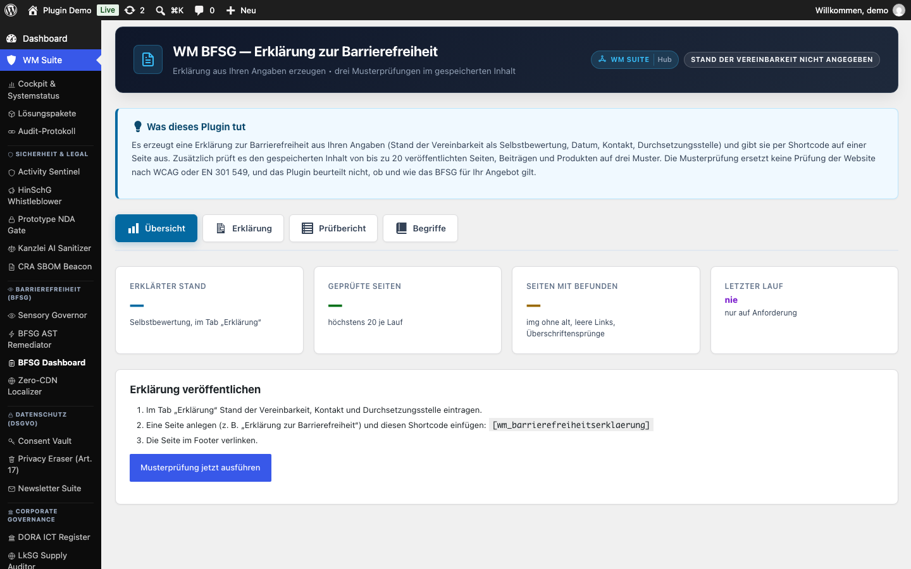

# WM BFSG Compliance Dashboard (Български)

  [🇧🇬 Български](README.bg.md) • [🇨🇿 Čeština](README.cs.md) • [🇩🇰 Dansk](README.da.md) • [🇩🇪 Deutsch](../../README.de.md) • [🇬🇷 Ελληνικά](README.el.md) • [🇬🇧 English](../../README.md) • [🇪🇸 Español](../../README.es.md) • [🇪🇪 Eesti](README.et.md) • [🇫🇮 Suomi](README.fi.md) • [🇫🇷 Français](README.fr.md) • [🇮🇪 Gaeilge](README.ga.md) • [🇭🇷 Hrvatski](README.hr.md) [🇭🇺 Magyar](README.hu.md) • [🇮🇹 Italiano](README.it.md) • [🇱🇹 Lietuvių](README.lt.md) • [🇱🇻 Latviešu](README.lv.md) • [🇲🇹 Malti](README.mt.md) • [🇳🇱 Nederlands](README.nl.md) • [🇵🇱 Polski](README.pl.md) • [🇵🇹 Português](README.pt.md) • [🇷🇴 Română](README.ro.md) • [🇸🇰 Slovenčina](README.sk.md) • [🇸🇮 Slovenščina](README.sl.md) • [🇸🇪 Svenska](README.sv.md)

---

  
  
  
  
  

> **Builds the German accessibility statement (Erklärung zur Barrierefreiheit) from what the operator enters and runs three pattern checks on the stored content of up to 20 published pages — a drafting aid for a self-assessment, not a WCAG audit and not a legal verdict**  

---

## 📸 Български Enterprise Showcase

!WM BFSG Compliance Dashboard Banner

---

## 🟢 НИВО 1: РЪКОВОДСТВО ЗА НАЧИНАЕЩИ И СЪЗДАТЕЛИ НА САЙТОВЕ (NO-CODE)

### Какво прави тази добавка за вашия уебсайт?
Builds the German accessibility statement (Erklärung zur Barrierefreiheit) from what the operator enters and runs three pattern checks on the stored content of up to 20 published pages — a drafting aid for a self-assessment, not a WCAG audit and not a legal verdict

### 🚀 Как да започнете за 2 минути (Стъпка по стъпка):
1. Install and activate the plugin (WordPress 6.4+, PHP 8.2+).
2. Open **BFSG Dashboard › Erklärung** and enter the company, the website, the date of your self-assessment, the level of conformity your own assessment of the site supports, the feedback e-mail and, if you want them listed, a contact person and a phone number. Check the enforcement body and save.
3. Create a page (for example "Erklärung zur Barrierefreiheit"), insert the **Erklärung zur Barrierefreiheit (BFSG)** block or `[wm_barrierefreiheitserklaerung]`, publish it and link it from the footer.
4. Optionally run **Musterprüfung jetzt ausführen** on the overview and read the findings under **Prüfbericht**.

### 💡 Често задавани въпроси за начинаещи:
#### ❓ What is not included?
No check of the rendered site (theme, menus, widgets, forms, colour contrast, keyboard operation, ARIA, scripts); no test against WCAG 2.2, BITV 2.0 or EN 301 549; no check beyond 20 items; no PDF, CSV or other file export; no certificate, seal or custom database table; no scheduled or continuous monitoring; no feedback inbox; no assessment of whether or how the BFSG applies to an offer.

---

## 🟡 НИВО 2: РЪКОВОДСТВО ЗА УЕБМАЙСТОРИ И АДМИНИСТРАТОРИ

### What the plugin does
1. **Accessibility statement.** `Anlage3Generator::generate_declaration()` builds a German HTML statement in four sections: the level of conformity as the operator's self-assessment (one of `vollständig konform`, `größtenteils konform`, `nicht konform`; without one the statement says "Der Stand der Vereinbarkeit ist noch nicht angegeben."), the date of the self-assessment the operator saved (without one: "Das Erstellungsdatum ist noch nicht angegeben.") with the note that it rests on a self-assessment, the feedback contact (e-mail; contact person and phone only when they are set), and the enforcement procedure with the configured body. A closing line says that no external certification underlies it. Values come from the settings screen, then from the site (name, home URL, admin e-mail); nothing about the operator is invented.
2. **Shortcodes and Gutenberg block.** `[wm_barrierefreiheitserklaerung]`, `[wm_bfsg_anlage_3]` and `[wm_bfsg_statement]` print the statement. The attributes `company`, `url`, `level`, `email`, `phone`, `officer` and `authority` override the saved settings on that page; unknown attributes are dropped. The Gutenberg block `wm/bfsg-anlage-3` (`blocks/anlage-3/block.json`, editor script `wm-bfsg-dashboard-blocks-editor`) appears in the Block Inserter with `InspectorControls` for optional overrides and a live `ServerSideRender` preview.
3. **Pattern checks.** `AccessibilityAuditor::run_audit()` reads the stored `post_content` of up to 20 published pages, posts and products (newest first, sticky posts not moved to the front) and looks for three patterns: `img` elements without an `alt` attribute (WCAG 1.1.1), links without text and without `aria-label`, `aria-labelledby` or `title` (WCAG 2.4.4) and heading levels skipped downwards (WCAG 1.3.1). Each item starts at 100 points and loses 10 per finding, capped at 30, 20 and 20 per check; the overall score is the mean. No content checked means no score (`null`, state `NOTHING_CHECKED`), never 100. Each item is tagged `findings` or `no_findings`, never with a compliance label; the finding texts are German. The result is stored in the option `wm_bfsg_last_audit_results`. The checks run only on request.
4. **Admin.** Menu *BFSG Dashboard* (position 82), page `wm-bfsg-dashboard`, German interface with four tabs: an overview (declared level, pages checked, pages with findings, last run, the three steps to publish the statement, the button that runs the checks); the statement tab (settings form with the date of the self-assessment, level limited to the three values, opt-in uninstall data removal checkbox, sanitized `wp_kses_post` preview); the report of the last run (identifier, time, checks, result and a findings table per page, with the note that it is no certificate and no statement of legal conformity); a short list of terms. A dashboard widget shows the stored run and the declared level without running anything. Family sheets of the WM Suite admin.
5. **REST and WP-CLI** (`manage_options`): `POST /wp-json/wm-bfsg-dashboard/v1/run-audit` (`success` false when nothing was found to check), `GET /wp-json/wm-bfsg-dashboard/v1/preview-declaration` (statement from the saved settings), `GET /wp-json/wm-bfsg-dashboard/v1/audit-certificate` (summary of the stored run, read-only); `wp bfsg-audit scan` (exits with an error when nothing was found to check, lists the findings) and `wp bfsg-audit anlage3` (statement from the saved settings as plain text).
6. **Extensibility & block integrations.** Exposes filters `wm_bfsg_dashboard_declaration_html` and `wm_bfsg_dashboard_audit_report`, actions `wm_bfsg_dashboard_ready` and `wm_bfsg_dashboard_audit_completed`, WordPress 6.5+ Block Bindings source `wm-bfsg-dashboard/metrics` and GenerateBlocks 2.x Dynamic Tag `{{wm_bfsg_dashboard_metric}}`.
7. **WM Suite Hub spoke.** `includes/Adapters/Bfsg_Dashboard_Spoke_Adapter.php` registers through `wm_register_suite_module`: health `NEEDS_CONFIG` until a run has checked content, `HEALTHY` from a mean score of 80, `DEGRADED` below; telemetry with score, pages checked, pages with findings, check state, declared level (`NOT_SET` when unset) and last run; actions `self_test` and `run_audit`, which fail when nothing was checked.

### Not shipped
No check of the rendered site (theme, menus, widgets, forms, colour contrast, keyboard operation, ARIA, scripts); no test against WCAG 2.2, BITV 2.0 or EN 301 549; no check beyond 20 items; no PDF, CSV or other file export; no certificate, seal or custom database table; no scheduled or continuous monitoring; no feedback inbox; no assessment of whether or how the BFSG applies to an offer.

---

## 🔴 НИВО 3: РЪКОВОДСТВО ЗА РАЗРАБОТЧИЦИ И СОФТУЕРНИ АРХИТЕКТИ

Classes, hooks, options, the admin screen and the WM Suite Hub adapter are documented in the English manual: **[DEVELOPERS.md](../../DEVELOPERS.md)**.

---

## ⚖️ Европейско законодателство и съответствие

- **What the plugin establishes:** whether three patterns occur in the stored content of up to 20 published items, and a statement text built from what the operator enters. It does not test the site against WCAG 2.2 or EN 301 549, does not assess whether or how the BFSG applies to an offer, and does not make the statement true: the declared level of conformity is the operator's own claim, and a pattern check without findings does not support any level.
- **Outbound requests:** none.
- **Privacy:** no visitor data is collected; the plugin stores its statement settings, the last pattern-check run (which lists page titles and URLs) and the uninstall preference in WordPress options. Stored data is preserved on uninstall by default and removed only when the administrator opts in via `wm_bfsg_dashboard_delete_data_on_uninstall`.

---

## 🔒 Лиценз и права за интелектуална собственост

Distributed under the **GNU General Public License v2 or later**.  
Copyright (C) 2026 Arnold Wender.  
